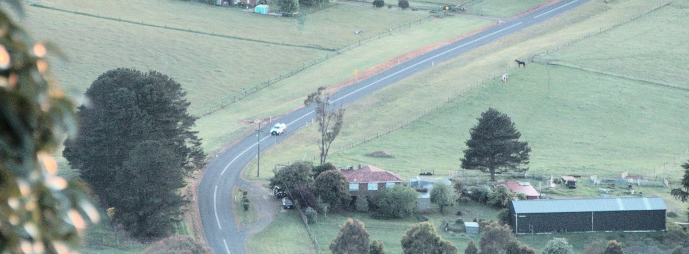
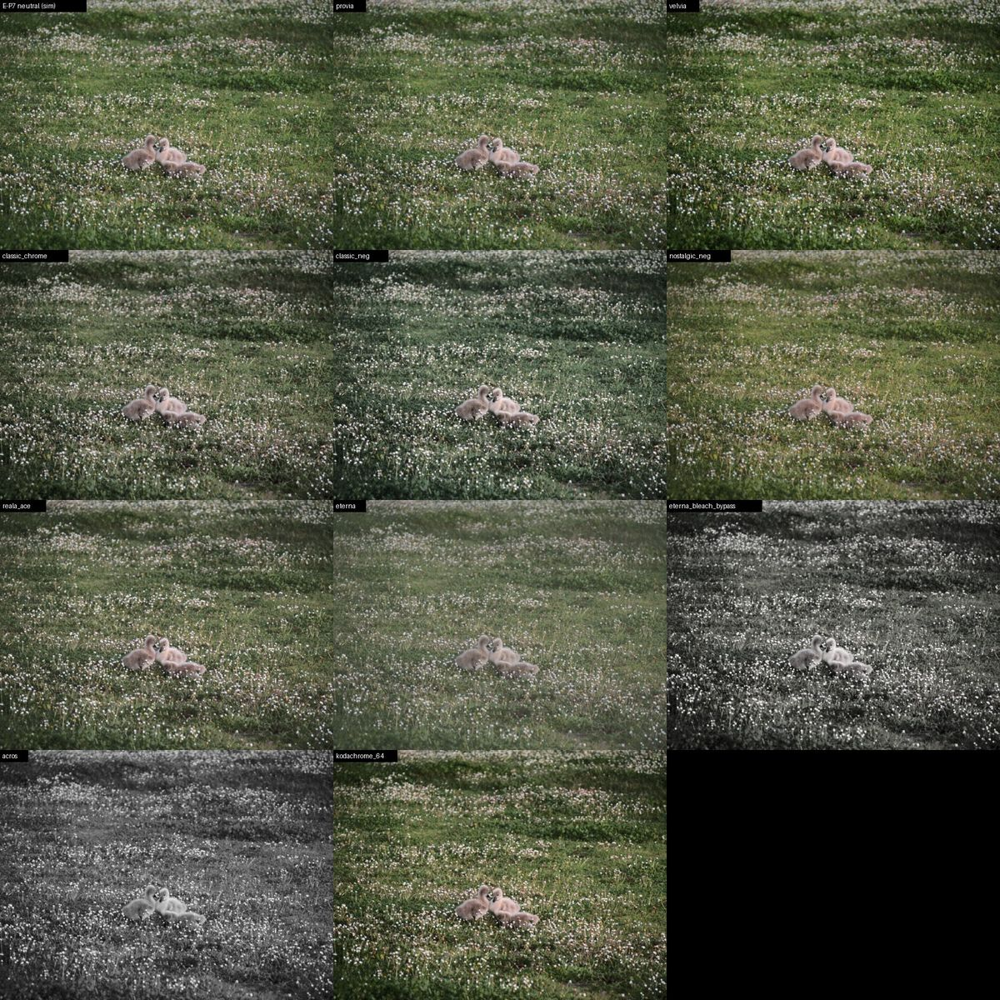
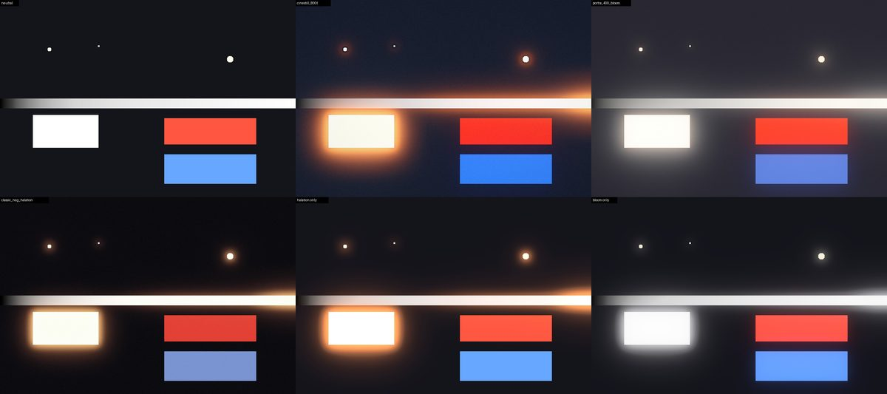
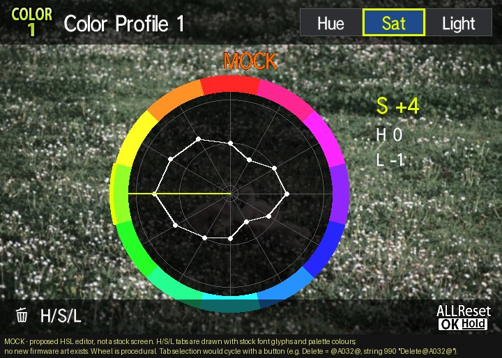

# Caduceus

[](https://buymeacoffee.com/cakelesscoder)

**Caduceus** is a set of open-source firmware patches for the **Olympus PEN E-P7** (firmware 1.1). Film simulations you can pick
and edit in the camera, per-profile HSL, grain, bloom, clarity and Art Effects, B&W film presets, true log video,
XPan and 21:9 stills, and longer video recording.

*Named after the caduceus, the staff of Hermes: messenger between gods and mortals and guide of travellers.*

Current release: **v0.15** (`releases/v0.15`). **Install: [docs/INSTALL.md](docs/INSTALL.md)** (`python3 caduceus.py build --release v0.15`). The camera's firmware screen shows the Caduceus version.

> **Status: pre-release testing.** Every patch is verified in an emulator of the camera's CPU before it goes
> on a camera. The SD update and recovery path is proven on a real E-P7 (including recovery from a bootloop),
> and the features marked **camera-tested** below run on a real camera. Flashing modified firmware can still
> brick your camera. Read [Safety](#safety) first.



## Features

| Feature | What you get | Status |
|---|---|---|
| **Film simulations** | 17+ colour film looks (library v2, incl. an Aerochrome-style false-colour IR look) in `EP7MOD/LOOKS.BIN`. Pick one per Colour Profile slot on the camera; its name shows in Picture Mode. | Camera-tested |
| **On-camera look editor** | The stock Colour Profile wheel gains pages: Saturation, Hue, Light, Film and Extras (INFO cycles). The wheel follows the page. Modified looks are marked `*`. | Camera-tested |
| **Profile bundles** | Each Colour Profile slot (COLOR1–4) carries its own full look: per-colour hue and lightness on top of the stock saturation and tone. | Camera-tested |
| **Looks on the SD card** | Looks load from `EP7MOD/BUNDLES.BIN` on the first half-press. Edits made in the camera save back to the card (with a `.BAK` of the previous file). | Camera-tested |
| **Per-profile WB shift** | Each slot carries its own A/B and G/M fine-tune. | Camera-tested |
| **Colour film grain** | The E-P7's grain hardware, previously Monochrome-only, on colour profiles. | Camera-tested |
| **Bloom and clarity** | The Soft Focus engine as a subtle Pro-Mist glow, or inverted as clarity (one Extras slider, glow ← 0 → clarity). | Camera-tested |
| **Art Effects on colour profiles** | Star Light, Pin Hole or Blur per slot (Extras sector 5), using the camera's own Art Effect stages. | Camera-tested (live-view preview partial) |
| **Mono film presets** | Pan F 50, Acros, T-Max 100, SFX 200, Tri-X 400, HP5 Plus, Delta 3200, Sepia Print, Selenium, Cyanotype for Monochrome Profile slots (INFO in the mono filter/shading editor), built from OM's own mono settings. Label `Film: <name>`, `*` when modified. | Camera-tested |
| **Live-view preview** | Hue/light and bloom shown in live view, not only in the saved photo. | Camera-tested |
| **True log video** | A hidden OM-Log-style curve already present in the firmware (~12.4% output per stop), unlocked by setting the **movie** picture mode to Muted. Live view shows the flat log image. | Camera-tested |
| **XPan 65:24 and 21:9** | Panorama (5184×1920) and Wide (5184×2224) in the menu and Super Control Panel, with matching live view and playback framing and `XPAN`/`UW` size labels. Boots back to 4:3 each power-on for safety. | Camera-tested |
| **Recording limit** | 29-minute and 2-hour caps raised to 9 hours (file, chapter and heat limits still apply). | Camera-tested |

## Using it

Card layout (copy the `card/EP7MOD` folder from a release to the card root):

```
EP7MOD/BUNDLES.BIN   your four slots: looks, names, edits (written by the camera; .NEW/.BAK alongside)
EP7MOD/LOOKS.BIN     the film library the Film page picks from
```

- Switch on and **half-press once**: the card looks load (nothing is read at boot). Without the folder the
  camera behaves as stock.
- Open a Colour Profile's colour wheel. **INFO** steps: Saturation → Saturation · All → Hue → Light →
  Film → Extras. Turn the dial to change the value; on Film it steps through the library.
- Extras (sectors 1–5): grain, glow/clarity, WB amber/blue, WB green/magenta, Art Effect.
- Monochrome Profile editor (filter or shading): **INFO** steps through the mono film presets (`Film: <name>`).
- Leave the editor and half-press: changes are saved to `BUNDLES.BIN`. The previous file is kept as `.BAK`.
- Picking a film look replaces that slot's hue, light and extras (saturation stays yours). Tweak on top
  after picking; the label shows `*` once the slot differs from the look.

### Film looks

Recipes inspired by Fujifilm film simulations, built only from controls the patched camera has.
Desktop previews from E-P7 RAW files:



Halation and bloom in the desktop simulator (bloom also runs in-camera; halation is desktop-only for now):



### Log video

Left: the camera's standard curve. Right: the hidden log curve, rendered with the firmware's own tone table.


### UI

Mock-ups drawn with the camera's own fonts and icons, extracted from its firmware.

| Stock Colour Profile editor | HSL editor (early mock-up) |
|---|---|
|  |  |
| **Image Aspect menu with XPan / 21:9** | **XPan framing** |
|  |  |

## Roadmap

- More film looks, and a cross-platform web app to build and share `LOOKS.BIN` files.
- Art Effect live-view preview that updates immediately.
- Parked: colour looks on MONO slots / extra profile slots; a list-style menu instead of the wheel.
- Tinted halation (red glow around white lights), probably via a mask built from the exposure meter grid.

## How it works

- The stock firmware is downloaded from OM's own update server by `tools/fetch_stock.sh` and checked by hash.
  **This repository contains no OM firmware.**
- Patches are small MN103 assembly routines and data edits. Each one has a build script that checks every
  stock byte it replaces, places code only in verified free space (`docs/CODE_SPACE_MAP.md`), and emits an
  edit list.
- `tools/build_package.py` turns edit lists into an update file for the camera's own SD updater, plus a
  matching stock-restore file. It refuses overlapping edits or unexpected stock bytes.
- Every patch has an emulator test that runs the real camera code, patched against stock, and checks that
  only the intended values change. Every package is checked to decode to exactly the emulated image, and its
  restore file to exactly stock.
- Runtime state lives only in heap memory the loader allocates; patches never write into the firmware image
  in RAM.
- A desktop colour pipeline (`sim/`), calibrated against the camera's own JPEGs, previews looks on your RAW files.

## Safety

- Only the E-P7 on firmware **1.1** is supported.
- The camera's SD updater (hold **OK** while switching on, file at `DCOLYMP/E1429999.BIN`) is confirmed working:
  LED steady while writing, then a ~2 Hz blink when done. It rejects corrupt files without writing, and stock
  firmware has been restored through it, including from a bootloop.
- A full battery and an uninterrupted write are essential. A failed write can leave the camera unbootable.
- Each release folder has a `restore-stock.pkg.bin`; keep it on hand. Follow the camera plan in the release's
  `README.md`. Removing `EP7MOD` from the card returns every look feature to stock behaviour.

## Build

```bash
git clone --recurse-submodules <repo>
cd caduceus-ep7
tools/fetch_stock.sh          # downloads OLY_E_142_1100_0000_0000.BIN from OM and checks its hash
tools/setup_toolchain.sh      # GNU binutils for mn10300
tools/decode_stock.sh
python3 -m venv .venv && .venv/bin/pip install rawpy numpy pillow
```

Per-patch build and verify commands are in each `patches/*/` folder and in `WORKLOG.md`.

## Credits

- [fishcu/oly_fw_analysis](https://github.com/fishcu/oly_fw_analysis): PEN-F firmware research, container
  codec and MN103 emulator harness this project builds on (used as a submodule).
- LightSnowDev, Altsoph/mx3 (CHDK forum), the DVXuser and Personal View Olympus threads, and iKenndac for
  earlier Olympus firmware research.
- Film-look references are listed in `docs/FILM_SIMS.md` and `docs/FILM_LOOK.md`.

## Support

Caduceus is free and open source. If it brings your E-P7 to life and you'd like to say thanks, you can
[buy me a coffee](https://buymeacoffee.com/cakelesscoder). Bug reports and camera test results are just as welcome.

## License

Caduceus patch code, tools and docs are released under the [GNU GPL v3](LICENSE). The OM firmware itself is
not included or redistributed: the builder downloads it from OM's own server on your machine.
Community film recipes are credited to their authors in `docs/LIBRARY_V1.md`.

Not affiliated with OM Digital Solutions or Fujifilm. "Olympus", "PEN" and film names are trademarks of their owners.
