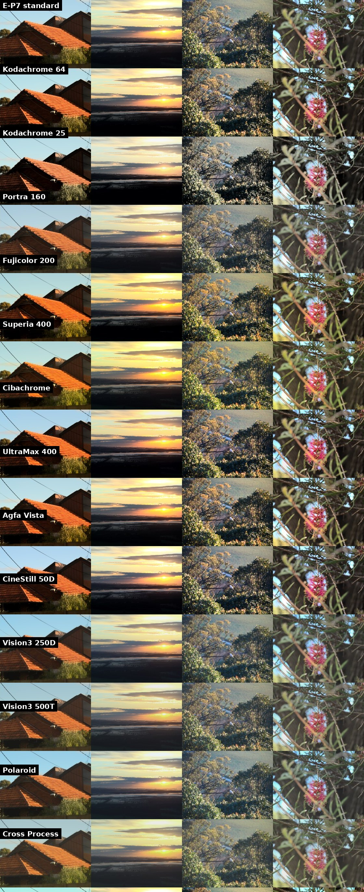
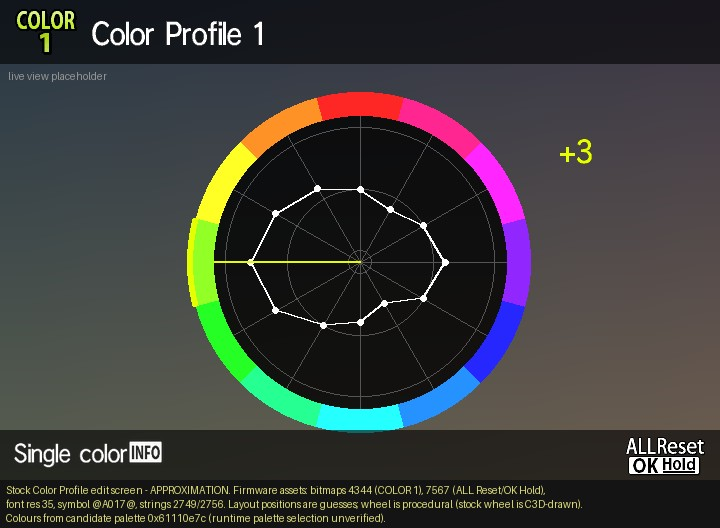
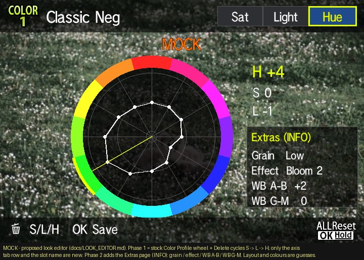
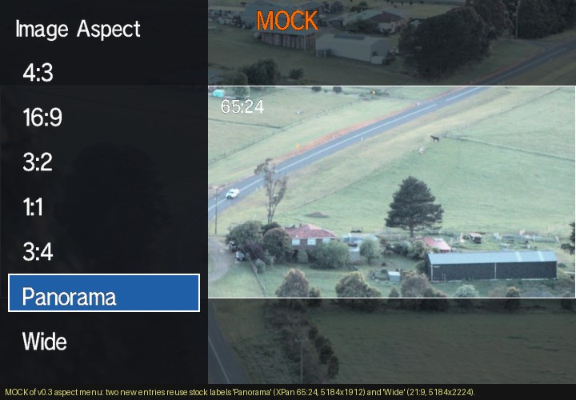
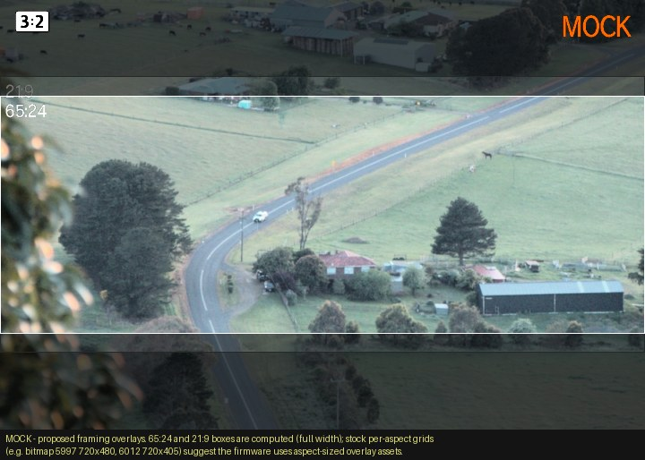
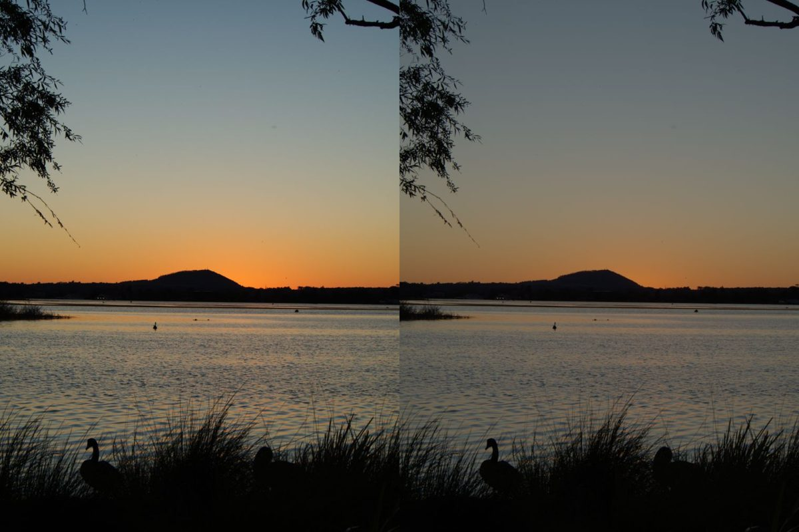

# Caduceus

[](https://buymeacoffee.com/cakelesscoder)

**Caduceus** is a set of open-source firmware patches for the **Olympus PEN E-P7** (firmware 1.1). It adds
film simulations you pick and edit in the camera, per-colour hue and lightness, grain, bloom, clarity and Art
Effects on your colour profiles, B&W film presets, true log video, XPan and 21:9 stills, and longer video
recording.

*Named after the caduceus, the staff of Hermes: messenger between gods and mortals and guide of travellers.*

**Latest release: [v0.20](https://github.com/cakelesscoder/caduceus-ep7/releases/tag/v0.20)** ·
**[Install guide](docs/INSTALL.md)** · **[Changelog](CHANGELOG.md)** · **[Caduceus Control Panel](https://cakelesscoder.github.io/caduceus-ep7/)** (make and share looks in your browser) · The camera's Setup › Firmware screen shows the Caduceus version.

> [!WARNING]
> **Early development, use at your own risk.** Caduceus is unofficial, experimental firmware modification.
> Bugs will turn up, and flashing modified firmware can crash, freeze or brick your camera, corrupt photos or
> damage your SD card's data. **The author accepts no responsibility for any damage, data loss or other harm**
> to your camera, cards, files or anything else. It is provided "as is", without warranty of any kind (see the
> [Apache License 2.0](LICENSE), sections 7–8). Using it may affect your warranty with OM Digital Solutions.
>
> Every patch is checked in an emulator of the camera's CPU before it goes on a camera, the SD update and
> restore path is proven on a real E-P7 (including recovery from a bootloop), and features marked
> **camera-tested** below have run on a real camera. Read [Safety](#safety) before flashing.



## Features

| Feature | What you get | Status |
|---|---|---|
| **Film simulations** | 29 colour looks in `EP7MOD/LOOKS.BIN`: Velvia, Astia, Classic Chrome, Classic Neg, Nostalgic, Reala Ace, Eterna, Bleach Bypass, Kodachrome 25 and 64, Portra 160 and 400, Ektar 100, Gold 200, Ektachrome, UltraMax 400, CineStill 50D and 800T, Vision3 250D and 500T, Pro 400H, Fujicolor 200, Cuban Neg (inspired by Osan's Classic Cuban Neg), Agfa Vista, Cibachrome, Polaroid, Cross Process, Atrophy (inspired by [Gx]Ace) and Faux IR (an infrared-inspired false-colour look). Pick one per Colour Profile slot; its name shows in Picture Mode. | Camera-tested |
| **On-camera look editor** | The stock Colour Profile wheel gains pages: Saturation, Hue, Light, Film and Extras (INFO cycles). The wheel follows the page; modified looks are marked `*`. | Camera-tested |
| **Looks on the SD card** | Looks load from `EP7MOD/BUNDLES.BIN` on the first half-press. Edits made in the camera save back to the card (with a `.BAK` of the previous file). | Camera-tested |
| **Tone per look** | Every film look carries its own tone curve: Highlights, Midtones and Shadows (applied through the camera's own tone control) plus new **Blacks** and **Whites** that move the very ends of the curve (crushed slide-film blacks, faded instant-film blacks, rolled-off negative highlights). Picking a look applies it; Blacks/Whites are also adjustable per profile (Extras 6/7). Shown in live view too. | New in v0.20 |
| **LCD colour fix** | The rear screen no longer looks slightly pink (+8 % green by default), and Monitor Adjust's colour slider becomes a green ↔ magenta slider (−7..+7, about 2.3 % per step) instead of warm/cool. Display only: photos, movies and HDMI are unchanged. | New in v0.20 |
| **Extras per profile** | Colour film grain (the E-P7's mono grain hardware, on colour), bloom ↔ clarity (one slider), WB amber/blue and green/magenta shift, and Art Effects (Star Light, Pin Hole, Blur). | Camera-tested |
| **Mono film presets** | Pan F 50, Acros, T-Max 100, SFX 200, Tri-X 400, HP5 Plus, Delta 3200, Sepia Print, Selenium, Cyanotype for Monochrome Profiles, built from OM's own mono settings. Label `Film: <name>`, `*` when modified. | Camera-tested |
| **Live-view preview** | Hue, lightness and bloom show in live view, not only in the saved photo. | Camera-tested |
| **True log video** | A log curve Olympus left hidden in the firmware, switched on with the **movie** picture mode set to Muted. | Camera-tested |
| **XPan 65:24 and 21:9** | Panorama (5184×1920) and Wide (5184×2224) in the menu and Super Control Panel, with matching live view and playback framing and `XPAN`/`UW` size labels. Boots back to 4:3 each power-on, for safety. | Camera-tested |
| **LCD tint fix** | The rear screen's factory pink cast is corrected, and Setup › Monitor Adjust's colour slider becomes a green↔magenta slider so you can fine-tune it. Display only: photos, video and HDMI are untouched. | New in v0.20 |
| **Recording limit** | 29-minute and 2-hour caps raised to 9 hours (file, chapter and heat limits still apply). | Camera-tested |

## Install

You need: an E-P7 on firmware **1.1** (check *Setup › Firmware*), a **fully charged battery**, an SD card,
and a computer with [Python 3.10+](https://www.python.org/downloads/) (Windows, macOS or Linux).

### 1. Get Caduceus

On this page click **Code › Download ZIP** and unzip it (or `git clone` the repo).

### 2. Build the update file on your computer

OM's licence doesn't allow anyone to share their firmware, so the update file is made on your own computer.
The builder downloads OM's official 1.1 firmware from OM's server, checks it, and applies the Caduceus patches.

- **Easiest:** in the unzipped folder, double-click the launcher for your system:
  - Windows: `Build Caduceus (Windows).bat`
  - macOS: `Build Caduceus (Mac).command` (the first time: right-click › **Open**)
  - Linux: `build-caduceus-linux.sh`
- **Or from a terminal** in that folder: `python3 caduceus.py build --release v0.20`
  (Windows: `py caduceus.py build --release v0.20`).

It creates a folder with:

```
DCOLYMP/E1429999.BIN   the patched firmware update      → goes on the SD card
EP7MOD/                the film looks and your slots      → goes on the SD card
restore/E1429999.BIN   the original stock firmware        → keep on your computer (to undo Caduceus)
```

### 3. Copy to the SD card

Put the camera's SD card in your computer and copy the **`DCOLYMP`** and **`EP7MOD`** folders to the top
level of the card (next to the `DCIM` folder). The launcher offers to do this for you. Eject the card properly.

### 4. Flash the camera

1. Put the card in the camera. **Battery fully charged**, camera **off**.
2. **Hold the OK button** and switch the camera **on**. Keep holding OK until the status light comes on.
3. The light stays **steady** while the update is written (it can take as little as 10 seconds). **Do not switch off, open the
   battery door or remove the card.**
4. When the light starts **blinking (about twice a second)**, it's finished. Switch the camera off.
5. Switch it on normally. *Setup › Firmware* now shows **Caduceus** and the version.
6. On a computer, delete `DCOLYMP/E1429999.BIN` from the card (keep `EP7MOD`: that's where your looks live).

If the light blinks fast straight away with no steady phase, the camera rejected the file and nothing was
written. Rebuild and copy again.

### 5. Shoot

Switch on, **half-press the shutter once** (that loads the looks from the card), then open a Colour Profile
and press **INFO** to reach the Film page. See [Using it](#using-it).

### Undo / go back to stock

Copy `restore/E1429999.BIN` from your computer to the card as `DCOLYMP/E1429999.BIN` (replacing the patched
one) and flash it exactly as in step 4. The camera is then completely stock 1.1 again.

More detail, troubleshooting and FAQ: **[docs/INSTALL.md](docs/INSTALL.md)**.

## Make your own looks: Caduceus Control Panel

**[Caduceus Control Panel](https://cakelesscoder.github.io/caduceus-ep7/)** is where you edit the built-in looks
and make new presets, right in your browser:

- Tweak any look (per-colour hue, lightness and saturation, grain, glow/clarity, WB shift, Art Effect), or
  start a new one, with a live preview on example photos or your own (your photo never leaves your browser).
- **Share a look with a short code:** press *Share*, send the code or link, and anyone can paste it into the
  Control Panel to get the same look.
- **Export** your pack as `LOOKS.BIN`, copy it to `EP7MOD/` on your SD card, half-press, and your looks are
  on the camera's Film page.

## Using it

```
EP7MOD/BUNDLES.BIN   your four Colour Profile slots: looks, names, edits (the camera rewrites it; .NEW/.BAK alongside)
EP7MOD/LOOKS.BIN     the film library the Film page picks from
```

- Switch on and **half-press once**: the looks load from the card (nothing is read at boot).
- Open a Colour Profile's colour wheel. **INFO** steps: Saturation → Saturation · All → Hue → Light →
  Film → Extras. Turn the dial to change the value; on Film it steps through the library.
- Extras (sectors 1–7): grain, glow/clarity, WB amber/blue, WB green/magenta, Art Effect, Blacks, Whites.
- Monochrome Profile editor (filter or shading): **INFO** steps through the mono film presets.
- Leave the editor and half-press: changes are saved to `BUNDLES.BIN`. The previous file is kept as `.BAK`.
- Picking a film look replaces that slot's hue, light and extras (saturation stays yours). Tweak on top
  after picking; the label shows `*` once the slot differs from the look.
- **Log video:** set the movie picture mode to **Muted**. Live view shows the flat log image.

### On-camera UI

The images below are **mock-ups made on a computer to preview the features**. On the camera nothing new is
drawn: Caduceus reuses the camera's own screens, fonts and icons, so everything looks exactly like the
stock E-P7 UI. The colour wheel gets extra pages and its guide line shows the page or look name.

| Stock Colour Profile editor | Look editor (mock-up) |
|---|---|
|  |  |
| **Image Aspect menu (mock-up)** | **XPan framing (mock-up)** |
|  |  |

### Film looks

Recipes built only from controls the patched camera has. The previews above are from the desktop simulator
on E-P7 RAW files, so the camera's JPEGs can differ slightly. Several looks are converted from community
Olympus recipes (GarethB's Kodachrome 25 on mu-43.com, and om-recipes.com); sources and credits are in
[docs/LIBRARY_V1.md](docs/LIBRARY_V1.md).

### Make and share look packs (web app)

[`webapp/`](webapp/README.md) is a browser app for building your own `EP7MOD/LOOKS.BIN`. You can start from the
built-in library, edit the looks with sector sliders over an approximate live preview, and download the file or a
card zip. Single looks can be shared as short codes (`1BM9Y-B0K8X-…`) and whole packs as links. It is a static site
with no backend, and photos never leave the browser.

- Locally: `cd webapp && npm ci && npm run dev` (open http://localhost:5173), or `npm test` / `npm run build`.
- On a NAS: `cd webapp && docker compose up -d --build`. This serves nginx on port 8080 as a non-root user, at `/`
  and `/caduceus/`. To reach it from your own domain without opening ports, put a Cloudflare Tunnel (or any reverse
  proxy) in front, e.g. `example.com/caduceus*` → `http://caduceus-looks:8080`.
  [webapp/README.md](webapp/README.md) has the step-by-step setup and the share-code format.

### Log video

The E-P7 firmware already contains a proper log curve (about 12.4 % of output per stop) and a Flat curve:
the same kind of profiles Olympus ships as OM-Log400 and Flat on other TruePic VIII bodies. On the E-P7 they
are simply hidden: no menu can select them. Caduceus switches the log curve on when the movie picture mode is
Muted. Left: the standard curve. Right: the hidden log curve, rendered with the firmware's own tone table.



## Roadmap

- More film looks, and a cross-platform web app to build and share `LOOKS.BIN` files.
- Art Effect live-view preview that updates immediately.
- Tinted halation (red glow around white lights), probably via a mask built from the exposure meter grid.
- Vignette on colour profiles as Extras sector 8 (−5..+5, finer than stock), using the stock shading stage
  (plan: `docs/VIGNETTE.md`).
- Per-look tone on the Film page (LOOKS.BIN tone block: a pick applies the look's Highlight/Shadow/Midtone and
  Blacks/Whites), and a Blacks/Whites page on the tone-curve screen (plan: `docs/TONE_ENDS.md`).
- Far future (Ricoh GR-style): **highlight-weighted metering** (meter the whole frame but protect highlights) and
  **snap focus** (a preset focus distance used when the shutter is pressed straight through).
- Maybe: use the ART position on the mode dial as a quick "silent shutter" switch.
- Parked: colour looks on Monochrome slots or extra profile slots; a list-style menu instead of the wheel;
  4:3 "open gate" video.

## How it works

- **This repository contains no OM firmware.** The builder downloads OM's official file from OM's own update
  server and checks its hash.
- Patches are small MN103 assembly routines and data edits. Each one has a build script that checks every
  stock byte it replaces, places code only in verified free space (`docs/CODE_SPACE_MAP.md`), and emits an
  edit list.
- `caduceus.py` (and `tools/build_package.py` for developers) turns an edit list into an update file for the
  camera's own SD updater, plus a matching stock-restore file. It refuses unexpected stock bytes, and every
  output must match the release's published hashes.
- Every patch has an emulator test that runs the real camera code, patched against stock, and checks that
  only the intended values change. Every package is checked to decode to exactly the emulated image, and its
  restore file to exactly stock.
- Runtime state lives only in heap memory the loader allocates; patches never write into the firmware image
  in RAM.
- A desktop colour pipeline (`sim/`), calibrated against the camera's own JPEGs, previews looks on RAW files.

## Safety

- **No responsibility is accepted for damage of any kind.** You flash this at your own risk. This is
  early-development software: expect bugs.
- Only the E-P7 on firmware **1.1** is supported.
- The camera's SD updater (hold **OK** while switching on, file at `DCOLYMP/E1429999.BIN`) is confirmed working:
  LED steady while writing, then a ~2 Hz blink when done. It rejects corrupt files without writing, and stock
  firmware has been restored through it, including from a bootloop.
- A full battery and an uninterrupted write are essential. A failed write can leave the camera unbootable.
- Keep the stock restore file the builder makes (`restore/E1429999.BIN`). Flashing it returns the camera
  completely to stock 1.1.
- **No `EP7MOD` folder on the card = almost stock.** All film looks, the look editor pages, Extras and mono
  presets only run when `EP7MOD/BUNDLES.BIN` is on the card, and nothing is read from the card until the
  first half-press. Without the folder (or with no card in) only these small, always-on changes remain:
  - log video when the **movie** picture mode is Muted;
  - the extra Panorama / Wide aspect options (the camera always boots back to 4:3);
  - the longer recording limit;
  - the Caduceus version on the Setup › Firmware screen.
- If something misbehaves: remove the `EP7MOD` folder first. If that doesn't help, flash the restore file.

## For developers

```bash
git clone --recurse-submodules https://github.com/cakelesscoder/caduceus-ep7
cd caduceus-ep7
tools/fetch_stock.sh          # downloads OLY_E_142_1100_0000_0000.BIN from OM and checks its hash
tools/setup_toolchain.sh      # GNU binutils for mn10300
tools/decode_stock.sh
python3 -m venv .venv && .venv/bin/pip install rawpy numpy pillow
```

Per-patch build and verify commands are in each `patches/*/` folder and in `WORKLOG.md`. Design notes are in
`docs/`.

## Support

Caduceus is free and open source. If it brings your E-P7 to life and you'd like to say thanks, you can
[buy me a coffee](https://buymeacoffee.com/cakelesscoder). Bug reports and camera test results are just as
welcome: please open an issue.

## Credits

- [fishcu/oly_fw_analysis](https://github.com/fishcu/oly_fw_analysis): PEN-F firmware research and the MN103
  emulator harness this project builds on (used as a submodule).
- LightSnowDev, Altsoph/mx3 (CHDK forum), the DVXuser and Personal View Olympus threads, and iKenndac for
  earlier Olympus firmware research.
- Community film recipes: GarethB (Kodachrome 25, mu-43.com), om-recipes.com contributors; see
  `docs/LIBRARY_V1.md`. Film-look references: `docs/FILM_SIMS.md` and `docs/FILM_LOOK.md`.

## License

Caduceus patch code, tools and docs are released under the [Apache License 2.0](LICENSE). The OM firmware itself is
not included or redistributed: the builder downloads it from OM's own server on your machine. The
`external/oly_fw_analysis` submodule (developer tools only) keeps its own licence. See [NOTICE](NOTICE).

Not affiliated with OM Digital Solutions or Fujifilm. "Olympus", "PEN" and film names are trademarks of their
owners.
