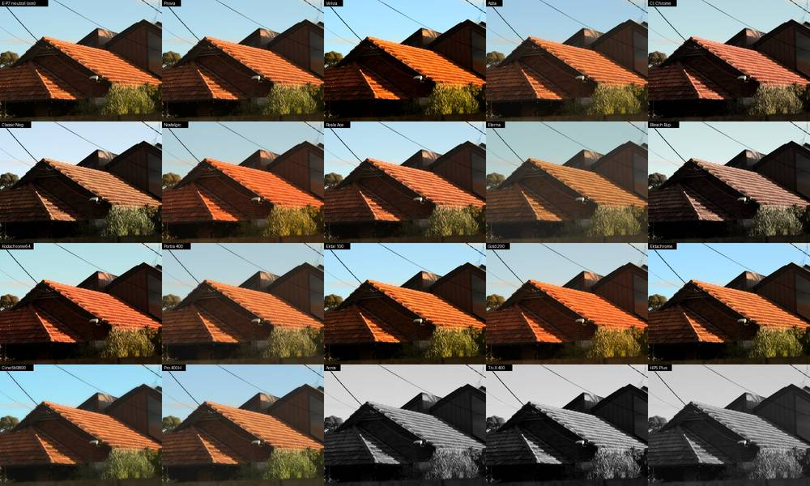
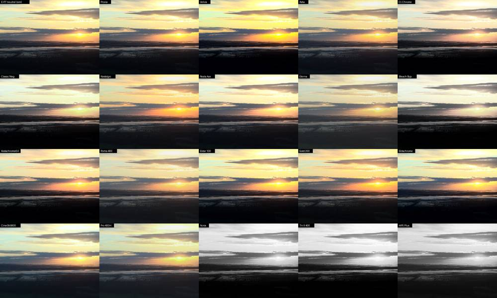
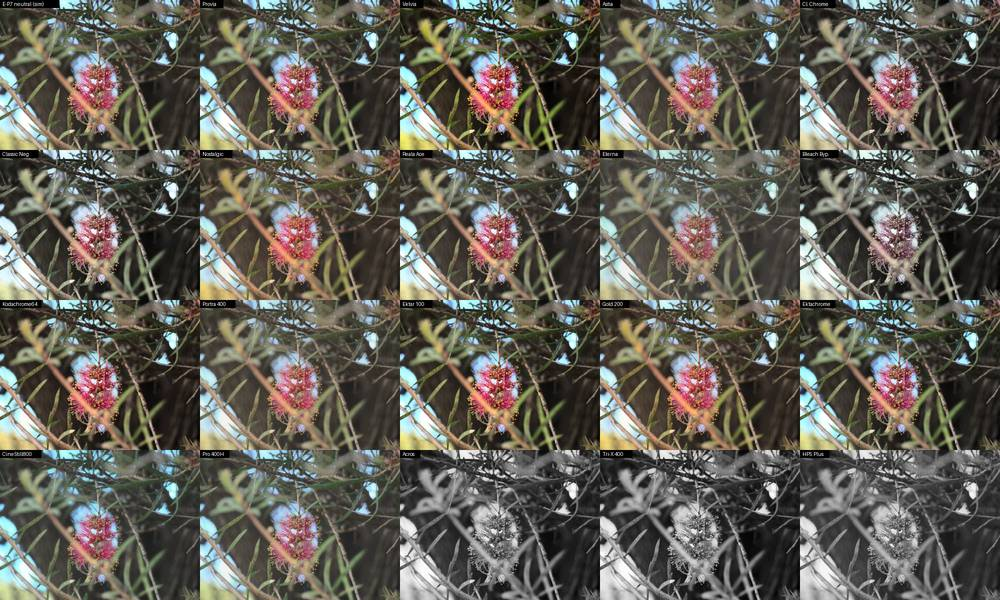
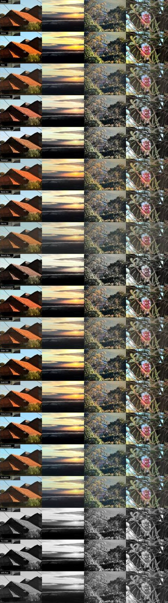

# Look library v1

19 named film looks for the E-P7 bundles/library mods: 16 colour and 3 mono. Every look uses only
controls the camera has or the bundle mods add. These are desktop-sim previews, not camera output. No
camera was connected.

- Recipes: `sim/recipes/library_v1.json` (fuji_like schema, keys `lib_*`). `patches/bundles/build.py`
  loads it through `RECIPE_FILES`.
- Library input: `bundles/library_v1.json` for `tools/ep7_library.py`. It has the names, grain, bloom,
  notes and an example slot assignment. Dry run: 19 looks, 3625 B, passes the loader rules.
- Previews: `sim/library_preview.py` writes contact sheets to `generated/library/`.

## What each control is in camera

| Control | Range used | Where it lives |
|---|---|---|
| hue[12], light[12] | −7..7 | bundle H/L (COLOR slots, or MONO slots with render_colour) |
| sat[12] | −5..5 | **the user's own per-profile saturation setting**. It is advice: the bundle does not set it. Kept within the stock ±5 |
| tone H/S/M, contrast | −4..4, −2..2 | user's stock picture settings (advice) |
| WB shift | −7..7 | bundle WB override. Looks without `wb_shift` keep the user's own fine-tune |
| grain | off/low/medium/high | bundle (v0.4). Colour gains 50/75/100, mono 110/300/600 |
| bloom | strength 1–5 | bundle effect (v0.4 Soft Focus blend, 8–35 % blurred share) |
| mono filter | stock | Monochrome Profile colour filter (user setting) |

None of the looks use halation, clarity or split toning.

## Looks

| Name | Grain / bloom | Description |
|---|---|---|
| Provia | – | Neutral, faithful colour reference: the E-P7 profile at zero. |
| Velvia | – | Saturated landscape slide film: deep skies, dense greens, crushed shadows. Now about 2× stronger than the old `velvia` recipe. |
| Astia | – | Soft slide film: gentle contrast, clean skin, slightly richer skies. |
| Cl. Chrome | – | Documentary look: muted greens and yellows, cyan skies, hard shadows. |
| Classic Neg | low | Superia-style negative: teal-green cast, punchy mids, light skies. The green sunset core of the old recipe is fixed. |
| Provia 400 | low | Fujichrome Provia 400X slide: darker and moody, warm red cast, lavender-leaning skies, dark muted greens, fine grain (replaced Nostalgic, 2026-11-05). |
| Reala Ace | – | Accurate, crisp modern negative: true hues, restrained greens. |
| Eterna | – | Cinema negative: flat, open shadows, quiet teal-leaning colour. |
| Bleach Byp. | low | Silver-retained cinema look: near-monochrome, harsh contrast. |
| Kodachrome64 | low | Rich reds, deep cyan-blue skies, warm and dense. Red sat and magenta are toned down, so skin no longer goes blotchy. |
| Portra 400 | low / bloom 1 | Warm pastel portrait negative: glowing skin, soft contrast. |
| Ektar 100 | – | Ultra-vivid fine-grain negative: saturated reds and blues. |
| Gold 200 | low | Golden consumer negative: sunny yellows, muted cyan skies. |
| Ektachrome | – | Clean, cool slide film: neutral skin, bright saturated blues. |
| CineStill800 | medium / bloom 3 | Tungsten cinema film: strong cool cast (WB B7 M1), lifted shadows, glowing lights. Bloom stands in for halation. |
| Pro 400H | low / bloom 1 | Airy pastel negative: minty greens, light cyan skies. |
| Acros | low (mono) | Fine-grain mono: deep blacks, smooth tones, darker reds (green filter). |
| Tri-X 400 | medium (mono) | Gritty reportage mono: punchy contrast, darker skies (yellow filter 2). |
| HP5 Plus | high (mono) | Soft, grainy mono with wide latitude and open shadows. |

Names are at most 12 characters, because the LIBRARY.BIN name field caps them there
(docs/FILM_LIBRARY.md). That is why some are shortened: "Kodachrome64", "CineStill800", "Bleach Byp.".

## Contact sheets

All looks on each test image. The first tile is the E-P7 neutral sim.

Red roof and sky (camera_t5/PB010073):

Sunset (PA211064):

Flower (camera_t5/PB010024):

Overview, one row per look: roof, sunset, valley (PA211089), flower:

## Caveats

- **The scales are uncalibrated.** Hue is 5.5°/step and WB is 1.5 %/step in the sim. On the camera the
  WB shift and hue twists may come out stronger or weaker. CineStill and Velvia are the most sensitive.
- **Colour grain is near-invisible in the sim.** At gains 50/75/100 it barely shows, even in the 50 %
  crop (`generated/library/detail_portrait_50pct.jpg`). GRAIN_PORT.md expects it to be weaker than mono
  grain. Mono grain is clearly visible.
- **Bloom is unverified on pixels.** It is modelled as the intended Soft Focus blend. If the combiner
  input order is reversed (BLOOM_HALATION.md risk 1), it will be much stronger.
- **Stock Olympus mono filters have no blue.** Acros therefore uses green, which only approximates
  ACROS's lighter blues.

## Library v2 (camera-tuned, test 13)

- Files:
  - recipes: `sim/recipes/library_v2.json` (keys `lib2_*`, registered in `patches/bundles/build.py`
    RECIPE_FILES);
  - library: `bundles/library_v2.json`.
- The card file `releases/test13/card/EP7MOD/LOOKS.BIN` holds the 16 colour looks with the same names. The
  slot resume still matches, and `--check` passes.
- Validation: `ep7_looks_bin.py --check` OK; `ep7_library.py --dry-run` OK.

**Camera finding: the WB fine-tune step is about 3× the sim's step.**
- Method: test-13 EXIF `WB_RBLevels` from the same lamp, comparing fine-tune 0/0 against 3/1, 2/2 and −7/1.
- Result: each A–B step moves R and B by about 4.4 % each; the sim assumed 1.5 %.
- So the v1 WB values, which were tuned in the sim, came out about 3× too strong on the camera.
- In v2 the WB values are re-scaled to camera steps. Previews use `WB_STEP` 0.044; `sim/film.py` is unchanged.
- Hue and light are still uncalibrated.

**Saturation is advice only.** The Film page does not set it, so set the profile's own saturation by hand.

| Look | v2 change (H/L in sector order Y,O,OR,R,M,V,B,BC,C,GC,G,YG) |
|---|---|
| CineStill800 | Halation stand-in: bloom 3→4; light OR/R +2; hue OR −1 (towards red); blue light −1. WB B7 G1 → **B3 G0**, so warm practicals stay warm and glow red-orange while daylight is still clearly cool. Sat advice OR +2, R +3; tone advice HL −1, SH +2. True red halation: docs/HALATION_RED.md |
| Kodachrome64 | No longer a copy of Cl. Chrome's hue. Hue: M +1, B −1, BC −2, C −1, GC +1, G/YG −1 (olive greens). Light: dense, −1..−2 everywhere. Sat advice: reds/OR +2. WB A3 → A1 |
| Velvia | Red hue −1 (towards magenta); light G/YG −1 (denser foliage) |
| Nostalgic | WB A3 → A2; orange hue +1 (amber) |
| Gold 200 | WB A4 M1 → A2 |
| Portra 400 | WB A3 G1 → A1 |
| Ektachrome | WB B2 → B1 |
| Pro 400H | WB B2 M1 → B1 |
| Classic Neg, Ektar 100 | WB +1 removed (no override, so the user's own fine-tune is kept) |
| Provia, Astia, Cl. Chrome, Reala Ace, Eterna, Bleach Byp. | unchanged |

Slots already saved with a v1 look keep the v1 values. To get v2, step the slot off the look and back on in
the Film page.

## Library v3 (12 more classic colour looks)

- Files: recipes `sim/recipes/library_v3.json` (keys `lib3_*`, each with a `source` field, registered in
  `patches/bundles/build.py` RECIPE_FILES); libraries `bundles/library_v3.json` (32 looks: v2's 17 colour, the 12
  new, then the 3 mono) and `bundles/library_v3_20.json` (≤20 fallback: best 20 colour looks, best first, no mono —
  mono uses its own presets).
- `releases/v0.15/card/EP7MOD/LOOKS.BIN` holds the **20-look** fallback until the 32-look loader is confirmed on the
  camera; then build `bundles/library_v3.json` with `tools/ep7_looks_bin.py` (2112 B, `--check` OK at MAX_LOOKS 32).
- Converting OM recipes: OM Color Profile 12-sector saturation = our sat advice, value for value (same order
  Y,O,OR,R,M,V,B,BC,C,GC,G,YG); contrast and highlight/mid/shadow are kept as advice; WB A/G fine-tune = our
  `wb_shift` a_b/g_m in camera steps. OM recipes have no per-sector hue/lightness, so small H/L moves are added here
  so the bundle itself carries part of the look (sat is advice only).

| Look | Grain / bloom | Intent | Source |
|---|---|---|---|
| Kodachrome25 | – | Dense slide: rich reds, muted cyan/green, deep shadows | GarethB, mu-43.com thread 92950 (2017) "My Kodachrome / Classic Chrome Pen-F settings". Sat verbatim; advice contrast +2, H−2 M+3 S−5. Source WB A−2 G+2 rendered too cold, bundle uses A0 G+1 |
| Portra 160 | – | Fine-grain portrait neg: natural skin, quiet greens | Isaac Mitropoulos, om-recipes.com/recipes/isaac-mitropoulos_portra-160 (5300K, A0 G0) |
| Fujicolor200 | low | Fuji C200: warm yellows, fresh greens | James Bloomer, om-recipes.com "OM-3 Fujicolor 200" (A2 G1) |
| Superia 400 | medium | Green-leaning consumer neg, cyan skies | James Bloomer, om-recipes.com "Fujicolor Superia Premium 400" (A3 G1) |
| Cibachrome | – | Glossy print: magenta-reds, deep blues | Jay, om-recipes.com "Cibachrome Print" (A1 G−1) |
| UltraMax 400 | medium | Warm punchy Kodak consumer neg | own design |
| Agfa Vista | low | Vivid magenta-leaning reds, cool punch | own design |
| CineStill50D | low / bloom 2 red | Clean daylight cinema, rich blues, faint glow | own design |
| Vision3 250D | low | Flat cinema neg, gentle teal/orange | own design |
| Vision3 500T | medium / bloom 1 red | Tungsten neg in daylight: cool teal, warm lights | own design |
| Polaroid | low / bloom 2 | Faded instant film, warm highs, cyan shadows | own design |
| Cross Proc. | medium | E-6 in C-41: hard, yellow-green highs, cyan skies | own design |

Credits: om-recipes.com is Ian Will's (mu-43 `ian_co`) collection of OM System Color Profile recipes (84 at the time,
launched Feb 2026); no AI/Claude authorship could be confirmed. Bloomer's recipes originate on
studioarchitecturecom.wordpress.com. Other Kodachrome 25 variants found but not used: Siegfried "VideoPic"
(myolympusomd.blogspot.com, PEN-F colour profiles page), BushmanOrig (same mu-43 thread, p.6). No Olympus recipes with
numbers were found for CineStill, Vision3, Agfa, Polaroid, Ektar or cross-processing, hence the own designs.

Fallback order (≤20): Classic Neg, Kodachrome25, Portra 400, Kodachrome64, Gold 200, Portra 160, Ektar 100, Velvia,
Cl. Chrome, Superia 400, UltraMax 400, CineStill800, Ektachrome, Pro 400H, Vision3 500T, Fujicolor200, Provia 400,
Eterna, Polaroid, Cross Proc. Dropped from it: Provia (= stock), Astia, Reala Ace, Bleach Byp., Aerochrome, Cibachrome,
Agfa Vista, CineStill50D, Vision3 250D, the mono looks.

### Atrophy (inspired by GxAce), replaces Provia

- **Inspiration.** "Atrophy" (GX-05) is a 20-preset Lightroom pack by [Gx]Ace (Casey Cavanaugh),
  gxace.com/shop/p/atrophy-lightroom-preset-pack. Its published description: grades for decay, industrial spaces and
  buildings reclaimed by nature, running from near-monochrome concrete (NULL_CHROMA, Isolation) to corroded colour
  (Labyrinth), with heavy weathered texture and contrast (Modernity) and a cinematic mood. Its sample images have one
  colour left standing, such as red lanterns or a red handrail. Our look is an approximation built from that description. It uses no
  preset or LUT data, and it is not affiliated with or endorsed by GxAce. To get the real thing, buy the pack.
- **Recipe** `lib3_atrophy` (sector order Y,O,OR,R,M,V,B,BC,C,GC,G,YG):
  - hue `-2 -1 0 0 2 1 -2 -1 0 2 2 -1`: yellows toward ochre/rust, magenta toward red, blue toward steel-cyan,
    greens split teal (G/GC) vs olive (YG);
  - light `-1 0 -1 -1 -1 -1 -2 -2 -1 -2 -3 -2`: dense darks, heavy foliage, darker skies; skin is untouched;
  - grain low (now 220, already gritty) plus **clarity 3** for the weathered texture, so the look has no bloom;
  - WB A−1 G+1, a slight cool-green cast.
- **Advice:**
  - sat `-2 -1 1 1 -3 -4 -4 -4 -4 -5 -5 -5`, which keeps the near-grey base while rust and reds survive;
  - contrast +1;
  - highlights −1, shadows −2.
- **Library slot.** The library was full at 32, so Atrophy took **Provia**'s place. Provia was the most redundant
  look: it is the E-P7 profile at zero, which is the same as having no look. Atrophy is listed after Cross Proc. and
  before the mono looks. `ep7_looks_bin.py --check` OK, 2112 B. The v0.16 working copy `releases/v0.16/card/EP7MOD/LOOKS.BIN` was rebuilt,
  because v0.17 did not exist yet. The rebuild changed the LOOKS.BIN CRC, so the camera ignores any old SLOTS.BIN and
  the slots must be picked again.
- **Sim check.** Compared with Bleach Byp., Atrophy keeps rust roofs and red flowers while it greys the greens and
  skies. Sunsets lose most of their gold.

### Cuban Neg (inspired by Osan's "Classic Cuban Neg"), replaces Superia 400

- **Inspiration.** "Classic Cuban Neg" is a Fujifilm film simulation recipe by Osan (Instagram @osanbilgi). It spread
  through a Fujifilm recipe group and is covered by FujiRumors (fujirumors.com/?p=128669, "This Recipe is Taking the
  Fujifilm Community by Storm – Classic Cuban Neg"). Published settings: Classic Negative, Grain Strong/Large, Color
  Chrome Strong, CC FX Blue Strong, Auto WB R+4 B−5, DR400, Highlights −2, Shadows +1, Color +4, Sharpness 0,
  Clarity −4, NR −4. Its character is a warm, golden Classic Neg with deep blues and reds, soft highlights, heavy
  grain and a soft rendering. Our look is our own translation of those published settings onto the E-P7 controls. It
  uses no other data, and it is not affiliated with or endorsed by Osan or Fujifilm.
- **Recipe** `lib3_cuban` (sector order Y,O,OR,R,M,V,B,BC,C,GC,G,YG):
  - hue `0 -1 0 0 7 6 -4 -3 6 7 5 0`: the Classic Neg twists (lib2_cl_neg), because the source is built on Classic Negative;
  - light `-1 -2 -3 -3 -1 0 -1 -2 -2 -3 -5 -4`: Classic Neg's darker warm colours and greens, plus darker reds
    (Color Chrome Strong) and darker blues/skies (CC FX Blue Strong);
  - grain low (Strong/Large in the source, but our low is already gritty) plus **bloom 1** (neutral) for Clarity −4;
  - WB **A+4 G0** for R+4 B−5: about +18 % amber, no green or magenta.
- **Advice:**
  - sat `2 2 2 2 0 -2 1 1 1 -2 -1 0` for Color +4 on a low-saturation base: warm colours up, greens held back;
  - contrast +1;
  - highlights +1 and shadows −3 (Classic Neg's hard tone with H−2 S+1 applied on top).
- **Library slot.** Cuban Neg takes the place of **Superia 400**, which was the most redundant colour look: our
  Classic Neg is already modelled on a Superia-style negative (teal-green cast, punchy mids). Cuban Neg is in the
  same position, after Fujicolor200. The `lib3_superia` recipe is kept because `bundles/library_v3_20.json` still uses
  it. The v0.17 `card/EP7MOD/LOOKS.BIN` was rebuilt with the v0.16-era tools (commit e477637), because the v0.17
  firmware is the v0.16 firmware. `--check` OK, 2112 B. The new CRC means the camera ignores any old SLOTS.BIN, so
  the slots must be picked again. In the starter `card/EP7MOD/BUNDLES.BIN`, the custom COLOR3 slot "Warm" is now
  Cuban Neg; every other slot is byte-identical.
- **Sim check.** Compared with Classic Neg, Cuban Neg is clearly warmer and more golden. Roofs and sunsets turn amber,
  skin is warm without going orange, skies stay a darker teal-blue, and the foliage is olive.

## v0.19 tone

Each look in `bundles/library_v3.json` now has `"tone": {highlights, shadows, midtones, blacks, whites}`.
H/S/M (−7..7) are the camera's own per-profile tone settings, written into the Colour Profile when the look is
picked. Blacks/Whites (−5..5) are the new end-point controls (docs/TONE_ENDS.md, `tools/ep7_tone.py`): Blacks > 0
lifts the black point to 8·B codes of 1023 (matte), < 0 crushes the toe; Whites < 0 lowers the white point to
1023 − 10·|W|, > 0 pushes the shoulder. Contrast stays as before (advice, not part of `tone`).

**H/S/M** are the values each look's recipe already carried (sourced advice, e.g. Kodachrome25 "H−2 M+3 S−5",
or the FILM_SIMS.md measured-LUT translations for the Fuji-style looks); none changed. **Blacks/Whites** follow the
film's character: slide films crisp (B −1..−2, W 0..+1), negatives a soft roll-off (W −1..−2), cinema negatives a
slight lift (B +1), Polaroid and Atrophy faded blacks (B +3). Changes are kept small: B ±1 moves the black end by
8–12 codes, W ±1 the white end by 10–12 codes.

| look | H | S | M | B | W | rationale |
|---|---|---|---|---|---|---|
| Velvia | 1 | −4 | 0 | −2 | 1 | slide; measured crushed toe (L\* 4.1 vs PROVIA 9.5) |
| Astia | −2 | 1 | 0 | 0 | 0 | soft slide, softer shoulder already from H−2 |
| Cl. Chrome | 0 | −3 | 0 | −1 | 0 | hard toe (5.2), muted not glossy |
| Classic Neg | 4 | −2 | 1 | 0 | −1 | measured steep mids; negative roll-off |
| Provia 400 | −1 | −1 | −1 | −1 | −1 | slide: darker than 100F with lowered whites and a faster fall to black (replaced Nostalgic) |
| Reala Ace | 3 | 1 | 0 | 0 | −1 | crisp negative, soft toe (11.3) via S+1 |
| Eterna | −2 | 4 | 0 | 1 | −1 | most open toe (14.6) and lower shoulder: flat cinema |
| Bleach Byp. | 4 | −3 | 0 | −2 | 1 | silver retained: dense blacks, harsh whites |
| Kodachrome64 | −1 | −2 | 0 | −1 | 1 | slide, deep and dense |
| Portra 400 | −2 | 2 | 1 | 0 | −2 | soft portrait negative, long roll-off |
| Ektar 100 | 0 | −1 | 0 | 0 | −1 | vivid but a negative shoulder |
| Gold 200 | −1 | 0 | 1 | 0 | −1 | consumer negative |
| Ektachrome | 0 | −2 | 0 | −1 | 1 | clean slide |
| CineStill800 | −1 | 2 | 0 | 0 | −1 | cinema negative; bloom does the glow |
| Pro 400H | −2 | 3 | 2 | 1 | −2 | airy pastel negative |
| Faux IR | 1 | −2 | 0 | −1 | 0 | slide-based (Aerochrome is E-6), deep skies |
| Kodachrome25 | −2 | −5 | 3 | −1 | 0 | advice H−2 M+3 S−5 (GarethB); slide blacks |
| Portra 160 | −1 | 1 | 0 | 0 | −1 | advice H−1 M0 S+1 (Mitropoulos); negative |
| Fujicolor200 | 0 | −3 | 1 | 0 | −1 | advice H0 M+1 S−3 (Bloomer); negative |
| Cuban Neg | 1 | −3 | 1 | 0 | −2 | Classic Neg + H−2 S+1; DR400 soft highlights → W−2 |
| Cibachrome | −3 | −2 | 1 | −1 | 1 | advice H−3 M+1 S−2 (Jay); glossy print, rich darks |
| UltraMax 400 | 0 | −1 | 0 | 0 | −1 | consumer negative |
| Agfa Vista | 0 | −1 | 0 | 0 | −1 | consumer negative |
| CineStill50D | −2 | 2 | 0 | 0 | −2 | soft highlights (notes) |
| Vision3 250D | −3 | 3 | 0 | 1 | −1 | flat, wide-latitude cinema |
| Vision3 500T | −2 | 3 | 0 | 1 | −1 | open shadows, cinema |
| Polaroid | −3 | 4 | 1 | 3 | −2 | faded, low-contrast instant film |
| Cross Proc. | 2 | −3 | 0 | −1 | 1 | hard contrast, hot highlights |
| Atrophy | −1 | −2 | 0 | 3 | −1 | matte decay grade: lifted black under dense darks |
| Acros | −1 | −2 | 0 | −1 | 0 | deep blacks (toe 6.3), smooth tones |
| Tri-X 400 | −1 | −3 | 0 | −1 | 1 | punchy reportage |
| HP5 Plus | −2 | 1 | 0 | 0 | −1 | soft, wide latitude |

**Tone model for previews.** `tools/ep7_tone_model.py` gives the camera luminance LUT (256 × u16, 0..1023, display
domain, contrast-0 ROM LUT 0x604fa082) for any H/S/M, bit-exact with the native code (0x6034fcd2 knots,
0x6034ff93 spline bend): 99 emulator cases (42 single-field, 12 mixed, 40 random, 5 on the contrast +2 LUT), max
error 0. Per-field LUT deltas do **not** add up (max error 28 codes on the mixed checks: once Midtones ≠ 0 the
firmware swaps the curve the H/S knots act on), so the data (`tools/data/tone_hsm.json`) holds the knot gains,
the spline x tables and exact test vectors, and ports run the splines. Blacks/Whites go through
`tools/ep7_tone.py` `remap()`. `sim/film.py` applies the result luminance-only after the base curve and the
contrast model (`"_tone_model": "legacy"` restores the old guess); `sim/library_preview.py bundles/library_v3.json
<out>` renders the library with each look's tone.
