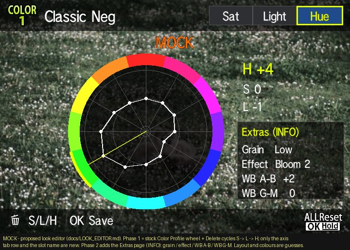

# In-camera look editor (E-P7 1.1): design

Offline design. Nothing here has run on a camera, no package or `E142*.BIN` was built, nothing was committed.
Base: `releases/test8-filmmenu` (v0.6, camera-proven). Rule kept throughout: **no run-time store into
0x60020020–0x6191ffe0**. Edits live in the loader's heap block (or proven .bss).

[V] = read from the decoded main with `tools/dis.sh` / byte dumps in this session. [I] = inference.
[P] = PEN-F fact from fishcu (`docs/color/pen-f/EDITOR.md`, `EDIT_AND_CAPTURE_MAP.md`, `SETTINGS_STORAGE.md`,
`patches/hsl/pen-f/src/editor_storage/editor.s`).

Mock: `sim/screens/look_editor.json` → `docs/img/ui_look_editor_mock.jpg`.



## 0. Goal and shape

Edit the **active slot** (COLOR1–4) from the camera:

| Field | Range | Where it lives | Phase |
|---|---|---|---|
| Saturation ×12 | −5..5 (stock) | stock setting IDs 927–962 / 1655–1666, saved by the camera as today | stock |
| Hue ×12, Light ×12 | −7..7 (phase 1: −5..5) | bundle table slot +0 / +12 (heap copy) | 1 |
| Grain | off/low/med/high | slot +24 | 2 |
| Effect | none / bloom 1–5 / clarity | slot +28/+29 | 2 |
| WB shift A–B, G–M | table range | slot +25/+26/+27 | 2 |

Same idea as fishcu's PEN-F HSL editor: reuse the stock Color Profile wheel editor and let **Delete cycle
S → L → H**. Unlike PEN-F, the values go into our bundle table (which the camera-proven readers already use),
and the card file stays the source of truth.

## 1. The E-P7 Color Profile editor (mapped this session)

### 1.1 Editor keys and children [V]

Editor descriptor table `0x61186ba4` (47 × `{u16 key, u16 n, u32 child_list}`, read by init `0x60e20aca`):

| Key | Children (setting IDs, `{kind 0, id}` pairs) | Profile |
|---|---|---|
| 0x13b3 | 1091 (cursor), 927–938 | COLOR1 |
| 0x13b4 | 1096, 939–950 | COLOR2 |
| 0x13b5 | 1097, 951–962 | COLOR3 |
| 0x140c | 1686, 1655–1666 | COLOR4 |
| 0x13a9 | 617, 618 | (CRT-like 2-value editor, as PEN-F 0x13a8) |

PEN-F keys were 0x13b2–0x13b4 with cursors 1095/1100/1101 [P]: the E-P7 keys are +1, the IDs −4, plus COLOR4.

Parent controller records (56 B, `0x61185bb0` 0x13a9, `0x61185be8` 0x13b3, `…c20` 0x13b4, `…c58` 0x13b5,
`…c90` 0x140c): `+0 key, +4 init 0x60e20a54, +8 child_get 0x60e20bc7, +12 Up 0x60e20e0a, +16 Down 0x60e2107a,
+20 Left 0x60e213bb, +24 Right 0x60e21852, +28/+32 dial handlers 0x60e21cae/0x60e21efb, +36 0x60e22191,
+40 0x60e223ae, +44 0x60e22579, +48 0, +52 0`. The two empty slots are a lead for a pure-data axis hook (§1.6).

Parent object: `+100 key (u16), +120 child count (13), +122 cursor, +124 child[0..12] (child[0] = sector cursor),
+176/+184 aux pointers, +108 timer`. Same as PEN-F's `+120 == 13`, `+124` cursor child [P].

Property child (constructor `0x60de34bb`, 144 B, vtable `0x61155a7c`): `+84 setting ID, +88 count, +90 current
index, +96 value codes, +100 value list` — **identical offsets to PEN-F** (`hsl_cycle` validates exactly these).
Refresh-from-settings `0x60de3670` reads count (facade +24) and value (facade +8) and searches the list; cursor
children are forced to 13 entries.

### 1.2 Events [V]

The E-P7 uses PEN-F's event numbers: `0x9004/0x9006` step, `0x9008/0x900a` sector left/right, `0x900c` commit,
`0x900d` release, `0x903e` held-OK reset (timer 537), `0xf855` direct/touch target. The key-repeat translator at
`0x60d1a6a0`/`0x60d1a73e` maps logical key 10 → **`0x9016`** (PEN-F Delete) [V]; that key 10 is the trash
button is [I] (strong: same event as PEN-F, the guide string 990 is `Delete@A032@`).

### 1.3 Value change and commit [V]

```
dial  0x60e22fb3 / 0x60e2302d   (setting 170 picks which dial moves the sector and which the value)
  → Up 0x60e20e0a / Down 0x60e2107a        (= PEN-F COLOR Up/Down 0x60cb0684/0x60cb08e5)
      mode = get(111) ∈ {54,55,56,64}; cursor = child[0] value (get 1091/1096/1097/1686)
      ALL (0x61fc3800 | 0x61fc3804 set): bound check 0x60e231e0 (max +5) / 0x60e230e0 (min −5), then all 12 children
      else child[cursor]: 0x9004/0x9006 step, then 0x900c commit
  → child handler 0x60dd5250 (hashed table 0x6114040c) → 0x900c → obj+76 = 0x60de5ab6 (fn table .data 0x61fc2728,
      init image 0x6025a9e8)
  → 0x60de5d67: facade SetValue(id, 0, values[+90])  — facade vtable+0 = 0x607fa129
  → GUI setter 0x607fa129: capture-status guards 0x6076a9ff, edit flag 0x60769db9(1/0)
      → 0x607fa355: call 0x60827440,[d2,d3,a2],16          ← **hsl_set_hook equivalent**
  → settings manager 0x60827440: 0x602af890 set, picture-mode refresh 0x602ccfcb/0x602cd045, listeners 0x608280ac…
```

`0x607fa355` stock bytes `dd eb d0 02 00 e0 10` are the same 7-byte `call …,[d2,d3,a2],16` shape fishcu hooked at
PEN-F 0x6073659d (`dd5096…e010`). d0 = ID, d1 = value, a0 = inner object, exactly the PEN-F `hsl_set` inputs.
0x60827440 has one other caller (0x607b2b19, non-GUI) which stays stock.

### 1.4 Getter, default, numeric label, ALL [V]

Everything in the editor reads through one facade object `OlyApiSettingControllerController`
(singleton `0x607f9062`, vtable **0x60acb0dc**, one vtable, one reference per slot):

| Slot | Address of word | Stock target | Role | PEN-F equivalent |
|---|---|---|---|---|
| +0 | 0x60acb0dc | 0x607fa129 | SetValue(id,flags,value) | GUI setter 0x607363b3 |
| +8 | **0x60acb0e4** | 0x607f9549 | GetValue(id,&out) → 0x602af887 | `hsl_get_pointer` 0x609a4668 |
| +24 | 0x60acb0f4 | 0x607f95dc | count | – |
| +28 | 0x60acb0f8 | 0x607f9912 | value-by-index | – |
| +152 | **0x60acb174** | 0x607f964a | GetDefault(id,&out) → 0x602afad0 | `hsl_default_pointer` 0x609a46ec |

Users that become axis-aware automatically once +8/+152 are redirected:
- numeric value label of the selected sector `0x60decabd` (ID table .data `0x61fc27e8`/`…2818`/`…2848`/`…2878`,
  12 IDs per profile; init image `0x6025aaa8`);
- "all at default" check `0x60decbfc` (compares +8 with +152: drives the ALL Reset guide);
- ALL group bounds `0x60e230e0`/`0x60e231e0` (bound −5/+5, PEN-F semantics: stop if any band is at the bound);
- child refresh `0x60de3670` (current index for the wheel numbers).

Both slot words are flash data in section 5 (load order 1,7,2,3,4,5,6,…): code placed in section 3 is
loaded before the word can be used.

### 1.5 Still unmapped (blocks a camera build)

| Item | PEN-F | E-P7 status / leads |
|---|---|---|
| Wheel **polygon** source (12 values + cursor → C3d) | 0x6081b780 cmd 5, 3 MOV hooks | Receiver `0x602dd8aa` (kind byte; kind 1 → value-code converter `0x602dcdb3`, payload 12 × s8 + cursor at +12). Callers 0x602e2412/0x602e262e ← 0x607989a0 (`fwOpe::drawC3dAsync` dispatcher 0x60798348, types 0–13) / 0x60939702. The producer for the COLOR wheel is not found; it does **not** use the facade ID tables. |
| Current-editor globals for the Delete handler | 0x6161b810 (holder: +0 parent, +4 viewer), 0x6161b81c (key), guards 0x61618eb0/0x6161ad04, dial marker 0x6161bf84 | not found. Lead: the null record slots +48/+52 (§1.6) would give a0 = parent directly. ALL flags are 0x61fc3800/0x61fc3804 [V]. |
| Viewer redraw call | `stock_viewer` + `stock_draw_request(65516,1,0,2)` | candidate 0x60e81064 (different convention, HSL_PORT); viewer update hooks 0x60db3072/0x60db3113 (medium). |
| Reset path for H/L | default getter + ordinary commit | the reset handler for `0x903e` was not followed past 0x60de5ab6 (not in its event list); the +152 redirect may already cover it. |
| Card write API | – | loader uses fopen/fseek/ftell/fread/fclose; fopen mode "w", fwrite and rename are not mapped. |

### 1.6 Hooks needed

Phase 1 (H/L axes, stock ±5 lists):

| # | Site | Bytes | Change | Conf. |
|---|---|---|---|---|
| H1 | 0x607fa355 | 7 | `call 0x60827440,[d2,d3,a2],16` → `call ed_set,[d2,d3,a2],16; nop×2`. ed_set: ID ∈ COLOR sector IDs ∧ axis ≠ S ∧ table loaded → range-check, write heap slot byte, mark dirty, return 1 (no settings write); else `jmp 0x60827440` | high (site) |
| H2 | 0x60acb0e4 | 4 (data) | 0x607f9549 → ed_get (CALLS/RETF, d0 id, a1 out). Axis ≠ S ∧ COLOR sector ID → heap value; else `jmp 0x607f9549` | high |
| H3 | 0x60acb174 | 4 (data) | 0x607f964a → ed_default (0 for H/L) | high |
| H4 | 0x60d1145e | 5 | `call 0x60d115c2,[],0` → `jmp ed_dispatch` (event at (16,sp) == 0x9016 in a COLOR editor → cycle axis, rewrite child +90 indices from the new values, redraw; else replay + `jmp 0x60d11463`) | high (site), globals unmapped |
| H5 | wheel polygon producer | ? | redirect its 12 values when axis ≠ S | unmapped |

Phase 1b (±7): the 72 + 24 schema edits, 6 + 2 ALL bounds, 13 wheel-geometry edits and wheel_encode from
`patches/hsl/ep7/port_map.json` (all high or medium), plus the touch bound 0x60e22f49/4d (`cmp ±5`, seen in this
session in the `0xf855` handler 0x60e22e96) and the value label/digit table (unmapped).

Phase 2 (extras page): a second axis set reached with INFO, or a small own list. Reuse is cheapest as a
4-child pseudo-page on the same wheel: sectors 1–4 = grain / effect / WB A–B / WB G–M, other sectors hidden.
This needs the polygon (H5) and label hooks; design only until phase 1 is proven.

Axis state: one byte in the heap block (P+684, see §2.3); invalid → S (stock behaviour). No .bss is needed.

## 2. Storage

### 2.1 (a) Write edits back to `EP7MOD\BUNDLES.BIN` (card is the source of truth) — **recommended**

- Live apply: ed_set writes the hue/light byte straight into the loaded table at
  `P + 32 + 64·slot + {0|12} + sector` (P = 0xa1f8d7ff + h, h at 0x622cbcc2), then sets the slot's flags bit1
  (write the value first, the flag last). P is heap, so this obeys the store rule. All flashed readers already
  read this copy through `tbl_idx`/`tbl_off` (v3 accessor), so the **next capture uses the edit** with no other
  change. A capture racing an edit can see one sector old, one new — the same non-atomicity PEN-F accepts.
- Persist: ed_set only sets a dirty byte (P+685). The file is rewritten **in the proven context**: the
  loader's HLS_EVENT TRIG1 hook (0x602c805f, test 7b/8 proven fopen path) gains a second branch "state valid ∧
  dirty ∧ medium OK" → build the 680-B image in a `malloc(1024)` scratch (header + table copy + names + `EP7N` +
  CRC-32 recomputed with the existing sd_crc), write `BUNDLES.NEW`, read back + CRC check, then
  `BUNDLES.BIN → BUNDLES.BAK` and `BUNDLES.NEW → BUNDLES.BIN` (if a rename API exists; else write `.BAK` copy first,
  then overwrite). Clear dirty only after the verified write. A loader v4 tries `.BIN` then `.BAK`.
- Edits made when no card table is loaded: editor stays stock S-only (no H/L axis). Matches "card = truth".

Risks: SD write is new on this camera (only reads are proven); FS concurrency with image writes (stock FS API
serialises, [I]); card full / write-protected / removed mid-write → `.NEW` incomplete, `.BIN` untouched; a torn
`.BIN` fails CRC → loader falls back to `.BAK`, then to the flashed table (stock-safe, never a bad pointer).
None of these touch internal flash: **worst case is a lost or stale look, not a brick.** The half-press write
adds latency to that one shutter press (≈ tens of ms [I]); writing on the half-press after the editor closes,
not during a burst, keeps it out of the way.

### 2.2 (b) Camera settings banks (PEN-F style)

PEN-F stores H/L as nibbles in part 1 of the saturation settings (`0x4831CCVV` words) and lets stock bank
save/recall carry them [P]. On the E-P7 that would be IDs 927–962 + 1655–1666 (48 words), part 1 at the
1769-word stride (HSL_PORT), plus the persist boot/refresh/commit hooks (mapped high in HSL_PORT) and a copy
into the heap table on boot and on bank recall (staging rules [P] §4).

| | (a) card | (b) settings banks |
|---|---|---|
| Source of truth | one: card file | two: settings vs card file (who wins on load/recall?) |
| Extras (grain/effect/WB) | free (same 64-B slot) | no room in 2-nibble words; more cells needed |
| Writes | SD card only | internal settings store (stock code, stock checksums) |
| Unknowns | fopen "w"/rename, write latency | part-1 cells for these IDs unverified on E-P7; recall staging; 4th profile |
| Failure mode | stale/lost look | bad values persisted in internal settings across reboots (needs reset; brick-adjacent if stock code reads part 1 somewhere [I]) |
| C1–C4 banks | no (one look per slot) | yes |

**Recommendation: (a).** It keeps the card the single source of truth, uses the readers and heap block that
test 8 proved, and its worst failure is a lost look. (b) is attractive only for C1–C4 bank integration and
is a later option.

### 2.3 Heap block additions (compatible with FILM_LIBRARY §8.3)

`P+680` `EP7E` marker (editor state valid), `P+684` axis (0 S, 1 L, 2 H), `P+685` dirty, `P+686` slot index of
the last edit, `P+688..` save scratch pointer. The loader already zeroes +544..+679; v4 also zeroes +680..+703
before publishing h.

## 3. Phased plan

| Phase | Content | Gate |
|---|---|---|
| 0 (RE) | Map: wheel polygon producer (H5), current-editor holder/guards, viewer redraw, fopen "w"/fwrite/rename. Try the record +48/+52 slots for 0x9016 first (pure data hook). | addresses + emulator probe of each |
| 1 | H/L axes, stock ±5 range, live apply to heap; Delete cycles S→L→H; **no save** (lost at power-off). Hooks H1–H4 (+H5). | emulator: native editor Up/Down/commit with H1–H3; get/default/set fall back byte-identical for every non-COLOR ID; store audit (only heap + stack) |
| 1s | Save to card (§2.1): loader v4 write branch + `.BAK` fallback | emulator: write/readback/CRC cases, torn-file cases; card first in a PC reader |
| 1b | ±7 range (port_map schema/bounds/geometry edits) | wheel and label checks |
| 2 | Extras page: grain, effect, WB | |

Smallest useful step for the user: **1 + 1s** in one flash (fewer flashes, bigger batches), but 1s only if the
write API is mapped and emulator-verified; otherwise ship 1 (live edits, re-made each power-on) and note it.

Code space claimed (docs/CODE_SPACE_MAP.md): section 3 `0x605b71a0–0x605b73e0` (ed_get/ed_default/ed_set,
568 B) and section 6 `0x61242a10–0x61242cf0` (ed_dispatch/cycle/redraw, 736 B; dead v1-loader range, same section as
the dispatcher). Both verified FF in stock. The look picker owns sec 5 `0x60b9dd00–0x60b9e000` and sec 9 `0x6143a400–0x6143a800`.

## 4. Camera test plan (after emulator gates; one flash; SD restore ready)

1. No card folder: Color Profile editor behaves stock (Delete does nothing new, S edits save and survive power
   cycle, ALL reset works). Shoot COLOR1–4. Any crash → restore.
2. Card with `BUNDLES.BIN`, half-press once: open COLOR2 editor, Delete → tab Light; dial a sector to +3; the
   number shows +3; Delete → Hue; Delete → Sat shows the stock S values unchanged.
3. Shoot a colour chart in COLOR2 before/after a Hue +5 on green: JPEG greens shift (live view will **not**
   show H/L: v0.2 residual risk 2).
4. (1s) Close the editor, half-press: `BUNDLES.NEW`/`.BAK` appear, `.BIN` CRC valid on the PC
   (`tools/ep7_bundles_bin.py`), power-cycle, half-press, values back.
5. Pull the card during a save half-press (spare card): camera keeps working, next boot uses `.BAK`/flashed.
6. Repeat 2–3 on COLOR4 (mode 64, IDs 1655–1666) and with ALL selected (group step and bound stop).

## 5. Status

Design and mapping only. The phase-1 build was requested afterwards; it is **not built**: H4 needs the
current-editor holder and H5 the polygon producer (§1.5), and neither is mapped yet. Phase 0 is the next task.

## 6. As built (test12-editor, emulator-verified, not camera-tested)

- Delete hook = the COLOR1–4 parent records' event word (+36 → parent+72, reached through router 0x60e20cdc).
  It needs no RAM globals. The init word (+4) resets the axis on open. This replaces H4 at 0x60d1145e.
- Save uses fopen "w" and fwrite 0x60635041. It runs from the loader's sd_back (0x605b7420) on the next half-press.
  Order: .NEW (read back) → old .BIN copied to .BAK → .BIN (read back). Heap state lives at P+680..686.
- Code: sec 3 0x605b7190 (529 B), sec 6 0x612429c0 (799 B). Range ±5 (phase 1b adds ±7). The polygon is still
  unmapped.
- Results and camera plan: `releases/test12-editor/README.md`; verifier `tools/ep7_verify_look_editor.py`.
